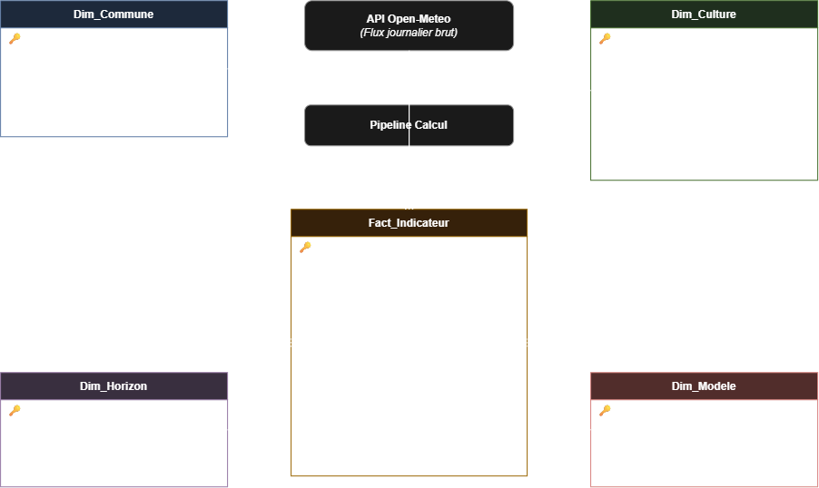

# SAÉ 3.01 — Livrable J1 : Dossier d'Analyse et de Conception (Pôle DATA)

Ce document formalise les travaux d'analyse, de modélisation relationnelle, de sourçage agronomique et de spécification des flux techniques conduits par le pôle DATA (analyse, puis conception de la base et du contrat d'interface) pour l'application d'aide à la décision agro-climatique à l'horizon 2050.

---

## 1. Référentiel des cultures et traçabilité agronomique

### 1.1 Justification du panel de cultures
Pour évaluer la résilience agricole métropolitaine, cinq cultures représentatives de la diversité des systèmes de production français ont été sélectionnées :
* **Grandes cultures annuelles d'hiver** : Blé tendre d'hiver et Colza d'hiver (piliers de la sole céréalière française, sensibles aux gelées printanières post-montaison et à l'échaudage estival).
* **Grande culture annuelle estivale** : Maïs grain (culture exigeante en chaleur et forte consommatrice d'eau, exposée aux restrictions d'irrigation estivales).
* **Culture légumière et féculière** : Pomme de terre (cycle estival sensible aux stress thermiques précoces et aux déficits hydriques).
* **Culture pérenne à haute valeur patrimoniale** : Vigne de cuve (marqueur historique du changement climatique, fortement exposée au décalage phénologique et aux gelées destructrices lors du débourrement).

### 1.2 Démarche d'audit et épuration des sources
Les sources généralistes de type Wikipédia ont été systématiquement écartées de notre entrepôt de données. Les seuils bioclimatiques ont été extraits et croisés auprès des instituts techniques professionnels et des organismes de recherche agronomique de référence :
* **ARVALIS - Institut du végétal** : références blé, maïs, pomme de terre.
* **Terres Inovia** : seuils de développement et stress hydrique du colza.
* **IFV (Institut Français de la Vigne et du Vin)** : seuils de dormance, débourrement et gel printanier.
* **SEMAE** : températures de base et biométrie germinative.
* **CNIPT** : filière pomme de terre.
* **INRAE (Portail Ephytia)** : pathologie thermique et accidents climatiques.

#### Données sourcées référence cultures

| id_culture | nom | t_base_c | gdd_maturite_cj | seuil_gel_c | besoin_eau_mm | t_opt_min_c | t_opt_max_c | seuil_stress_thermique_c | sources | urls | date_consultee | confiance |
| :---: | :--- | :---: | :---: | :---: | :---: | :---: | :---: | :---: | :--- | :--- | :---: | :---: |
| 1 | Blé tendre (hiver) | 0 | 2150 | -4 | 500 | 15 | 22 | 30 | ARVALIS (gel de printemps) \| Perspectives Agricoles (besoin en eau) | https://fiches.arvalis-infos.fr \| https://www.perspectives-agricoles.com/conduite-de-cultures/modelisation-des-besoins-en-eau-combien-consomment-les-cultures | 2026-09-25 | verifiee |
| 2 | Colza (hiver) | 5 | 2300 | -5 | 450 | 12 | 22 | 27 | ISAGRI (GDD) \| SEMAE (t_base) \| Terres Inovia (gel et eau) \| L'Eure Agricole (gel) | https://www.isagri.fr/ressources/articles/temps-thermique-lindicateur-cl%C3%A9-de-pr%C3%A9vision-des-stades-de-culture \| https://www.semae-pedagogie.org/sujet/implantation-et-developpement/ \| https://www.terresinovia.fr/fr/informations-techniques/colza/accidents-climatiques-sur-colza-gelees-printanieres \| https://www.terresinovia.fr/fr/informations-techniques/colza/accidents-climatiques-sur-colza-le-manque-ou-lexces-deau \| https://www.eure-agricole.fr/apres-les-meligethes-et-le-gel-quelles-consequences-pour-le-colza | 2026-09-25 | verifiee |
| 3 | Maïs grain | 6 | 1600 | 0 | 600 | 20 | 30 | 35 | Farmi (GDD) \| AgriRéseau (t_base) \| Catharsius (T opt) \| ISAGRI (irrigation) \| Perspectives Agricoles (eau) | https://www.farmi.com/article/somme-chaleur-germination-mais \| https://www.agrireseau.net/bovinslaitiers/Documents/bov14.pdf \| https://www.catharsius.fr/plante-mais/soin/temperature-et-humidite/ \| https://www.isagri.fr/ressources/articles/irrigation-quelle-quantit%C3%A9-deau-pour-assurer-de-bons-rendements- \| https://www.perspectives-agricoles.com/conduite-de-cultures/modelisation-des-besoins-en-eau-combien-consomment-les-cultures | 2026-09-25 | verifiee |
| 4 | Pomme de terre | 7 | 1500 | -2 | 600 | 15 | 20 | 28 | CNIPT (général) \| INRAE Ephytia (gel et chaleur) \| Perspectives Agricoles (eau) | https://www.cnipt.fr/ \| https://ephytia.inrae.fr/fr/C/21109/Pomme-de-terre-Gel-ou-froid \| https://ephytia.inrae.fr/fr/C/21111/Pomme-de-terre-Chaleur \| https://www.perspectives-agricoles.com/recherche-agronomie/pomme-de-terre-leau-un-facteur-de-production-et-de-durabilite | 2026-09-25 | verifiee |
| 5 | Vigne (raisin de cuve) | 10 | 1300 | -2 | 400 | 25 | 30 | 35 | IFV Vignevin (gel de printemps et bioclimatologie) \| INRAE Ephytia | https://www.vignevin.com \| https://ephytia.inra.fr | 2026-09-25 | verifiee |

### 1.3 Données consolidées de référence (`referentiel-cultures.csv`)

| id_culture | Nom | T° base (°C) | GDD maturité (°C·j) | Seuil gel (°C) | Besoin eau (mm) | T° opt min (°C) | T° opt max (°C) | Stress therm. (°C) | Organismes sources |
| :---: | :--- | :---: | :---: | :---: | :---: | :---: | :---: | :---: | :--- |
| **1** | Blé tendre (hiver) | 0 | 2150 | -4 | 500 | 15 | 22 | 30 | ARVALIS, Perspectives Agricoles |
| **2** | Colza (hiver) | 5 | 2300 | -5 | 450 | 12 | 22 | 27 | Terres Inovia, ISAGRI, SEMAE, L'Eure Agricole |
| **3** | Maïs grain | 6 | 1600 | 0 | 600 | 20 | 30 | 35 | Farmi, AgriRéseau, ISAGRI, Perspectives Agricoles |
| **4** | Pomme de terre | 7 | 1500 | -2 | 600 | 15 | 20 | 28 | CNIPT, INRAE Ephytia, Perspectives Agricoles |
| **5** | Vigne (raisin de cuve) | 10 | 1300 | -2 | 400 | 25 | 30 | 35 | IFV Vignevin, INRAE Ephytia |

*Toutes les données sont strictes (aucun intervalle textuel dans les attributs de calcul) afin de garantir l'intégrité des requêtes SQL et des scripts de traitement Pandas.*

---

## 2. Matrice de calcul des indicateurs agro-climatiques

| Indicateur | Objectif agronomique | Données d'entrée (API) | Paramètres seuils | Période de calcul | Formule mathématique / Algorithme | Unité & Format |
| :--- | :--- | :--- | :--- | :--- | :--- | :--- |
| **Somme thermique (GDD)** | Maturité physiologique avant l'hiver. | `temperature_2m_mean` | `t_base_c`, `gdd_maturite_cj` | Cycle complet de la culture | $\sum \max(T_{\text{moy}} - T_{\text{base}}, 0)$<br>*Spécificité Maïs :* $DJ = \max\left(\frac{T_n + \min(T_x, 30)}{2} - 6, 0\right)$ | °C·j cumulés |
| **Fréquence du gel critique** | Risque de destruction des organes verts ou floraux. | `temperature_2m_min` | `seuil_gel_c` | Fenêtre critique printanière (avril – mai) | $\sum 1$ pour chaque jour où $T_{\min} \le \text{seuil\_gel\_c}$ | Jours de gel critique / an |
| **Stress thermique** | Risque d'échaudage et d'avortement floral. | `temperature_2m_max` | `seuil_stress_thermique_c` | Maturation estivale (juin – août) | $\sum 1$ pour chaque jour où $T_{\max} \ge \text{seuil\_stress\_thermique\_c}$ | Jours de stress thermique / an |
| **Bilan hydrique** | Risque de déficit et stress hydrique sévère. | `precipitation_sum`, `t_min`, `t_max`, `t_mean` | `besoin_eau_mm` | Période de végétation active | $B = \sum (\text{Précipitations} - ET_0)$<br>avec $ET_0$ estimé via la formule d'Hargreaves | Bilan net en mm |
| **Verdict global 2050** | Aide à la décision stratégique pour l'exploitant. | Agrégations pluriannuelles | Ensemble des seuils | Horizon projeté (ex. 2041-2050) | Évaluation multicritère :<br>• `VIABLE` : GDD atteint ET gel rare ET bilan hydrique toléré<br>• `A_RISQUE` : Un facteur limitant fréquent<br>• `NON_VIABLE` : GDD insuffisant ou stress létal | `VIABLE`<br>`A_RISQUE`<br>`NON_VIABLE` |

### 2.1 Formalisation mathématique des indicateurs

#### 1. Fréquence du gel printanier
Soit $D_{\text{printemps}}$ l'ensemble des jours des mois d'avril et mai ($m \in \{4, 5\}$). Le nombre de jours de gel critique $N_{\text{gel}}$ pour une culture donnée s'exprime par :
$$N_{\text{gel}} = \sum_{j \in D_{\text{printemps}}} \mathbb{I}\left( T_{n,j} \le T_{\text{seuil\_gel}} \right)$$
* $T_{n,j}$ : température minimale journalière (`temperature_2m_min`).
* $T_{\text{seuil\_gel}}$ : seuil critique létal (ex. $-2\ ^\circ\text{C}$ pour la vigne, $-4\ ^\circ\text{C}$ pour le blé).
* $\mathbb{I}(E)$ : fonction indicatrice valant $1$ si la condition $E$ est vérifiée, $0$ sinon.

#### 2. Fréquence du stress thermique (Échaudage estival)
Soit $D_{\text{été}}$ l'ensemble des jours de la période estivale (juin à août) :
$$N_{\text{stress}} = \sum_{j \in D_{\text{été}}} \mathbb{I}\left( T_{x,j} \ge T_{\text{seuil\_stress}} \right)$$
* $T_{x,j}$ : température maximale journalière (`temperature_2m_max`).
* $T_{\text{seuil\_stress}}$ : seuil d'échaudage ou de blocage physiologique (ex. $35\ ^\circ\text{C}$ pour le maïs et la vigne).

#### 3. Somme thermique cumulée du Maïs avec plafonnement ($GDD_{\text{maïs}}$)
Pour chaque jour $j$, le degré-jour de croissance $DJ_j$ intègre la saturation enzymatique à $30\ ^\circ\text{C}$ (recommandations DRIAS / projet ORACLE) et le zéro de végétation ($T_{\text{base}} = 6\ ^\circ\text{C}$) :
$$DJ_j = \max\left( \frac{T_{n,j} + \min(T_{x,j},\, 30)}{2} - 6,\; 0 \right)$$
Le cumul annuel sur l'ensemble des jours $D$ de l'année s'écrit :
$$GDD_{\text{maïs}} = \sum_{j \in D} DJ_j$$

#### 4. Bilan hydrique et méthode d'Hargreaves-Samani ($ET_0$)
L'API Open-Meteo Climate renvoyant des valeurs nulles pour l'évapotranspiration $ET_0$, notre modèle applique l'équation empirique validée par la FAO :
$$ET_0 = 0{,}0023 \cdot R_a \cdot (T_{\text{moy}} + 17{,}8) \cdot \sqrt{T_{\max} - T_{\min}}$$
Le bilan hydrique net annuel $B$ sur la période active s'obtient par :
$$B = \sum_{j \in D} \left( P_j - ET_{0,j} \right)$$
* $P_j$ : précipitations journalières (`precipitation_sum` en mm).
* $R_a$ : rayonnement solaire extraterrestre calculé selon la latitude et le jour de l'année (DOY) avec les équations FAO-56, puis converti en mm/j d'évaporation équivalente (facteur $0{,}408$) pour que $ET_0$ soit exprimée en mm/j.

### Prise de recul scientifique sur les formules
1. **Plafonnement thermique du Maïs** : En accord avec les référentiels DRIAS et le projet ORACLE, la somme des températures pour le maïs plafonne la température journalière maximale à 30 °C. Au-delà de cette température, les processus enzymatiques de la plante saturent ou se dégradent, annulant tout bénéfice physiologique de la chaleur supplémentaire.
2. **Méthode d'Hargreaves-Samani pour $ET_0$** : L'API Open-Meteo Climate renvoyant des valeurs `null` pour le paramètre d'évapotranspiration $ET_0$, notre modèle applique la formule d'Hargreaves recommandée par la FAO :
   $$ET_0 = 0{,}0023 \cdot R_a \cdot (T_{\text{moy}} + 17{,}8) \cdot \sqrt{T_{\max} - T_{\min}}$$
   Le rayonnement solaire extraterrestre $R_a$ est modélisé directement à partir de la latitude de la commune et du jour de l'année (DOY).

---

## 3. Analyse de la dimension spatiale

### 3.1 Territoires retenus (`commune.csv`)
L'analyse s'appuie sur quatre communes cibles représentant des régimes bioclimatiques contrastés et emblématiques des cultures étudiées :

| id_commune | Commune | Code INSEE | Régime bioclimatique | Vocation agricole territoriale |
| :---: | :--- | :---: | :--- | :--- |
| **1** | Dijon | 21231 | Semi-continental | Vignoble de Bourgogne (sensible aux gels de printemps). |
| **2** | Strasbourg | 67482 | Semi-continental | Plaine d'Alsace (favorable au maïs, amplitude thermique forte). |
| **3** | Lille | 59350 | Océanique dégradé | Flandre / Bassin du Nord (grandes cultures, blé tendre, pomme de terre). |
| **4** | Rennes | 35238 | Océanique | Bretagne (climat tempéré humide, bassin clé du colza). |

### 3.2 Limites physiques de la donnée (Maille Open-Meteo ~10 km)
* **Maille physique vs Découpage administratif** : Les modèles climatiques globaux (CMIP6) ne délivrent pas une météo à l'adresse exacte, mais par cellules maillées d'environ $10\text{ km} \times 10\text{ km}$ (0,1°). Les données climatiques attribuées à chaque commune correspondent au centroïde administratif de celle-ci. Deux parcelles distantes de moins de 10 km partagent donc la même série météo simulée.
* **Lissage altimétrique et microclimats** : À l'échelle de cette maille de 10 km, le relief est nécessairement lissé. Les microclimats réels (cuvettes de gelée blanche, coteaux abrités, expositions sud pour la vigne) sont moyennés par le modèle. L'application doit donc être présentée aux exploitants comme un outil de tendance macro-climatique territoriale, et non comme un capteur parcellaire de précision.

---

## 4. Architecture décisionnelle : Schéma en étoile

Pour garantir des performances optimales sous AlwaysData (MySQL), la base de données est modélisée selon un schéma en étoile centré sur la table de faits des indicateurs calculés.

### 4.1 Règle d'or architecturale : L'API Open-Meteo comme flux externe
Les données météo journalières issues de l'API Open-Meteo (plusieurs centaines de milliers de lignes par simulation décennale) **ne sont jamais stockées en base de données**. L'API intervient comme un flux externe transitoire consommé en mémoire vive : le pipeline effectue les calculs agronomiques puis n'enregistre que les métriques agrégées dans `Fact_Indicateur`.

### 4.2 Schéma relationnel

<html>
    <p align="center">
    
    </p>
</html>


> **Évolution de conception** : la colonne `date_calcul` (DATETIME) a été ajoutée à `Fact_Indicateur` pour la purge RGPD (§8). Elle figure dans le script SQL et le schéma texte ci-dessous ; l'image sera mise à jour (§9).

### 4.3 Schéma relationnel Plaintext :

```txt
Plaintext
       +-----------------------+              +-----------------------+
       |      Dim_Commune      |              |      Dim_Culture      |
       +-----------------------+              +-----------------------+
       | * code_insee (PK)     |              | * id_culture (PK)     |
       |   nom                 |              |   nom                 |
       |   latitude, longitude |              |   t_base_c            |
       |   altitude_m          |              |   gdd_maturite_cj     |
       |   zone_climatique     |              |   seuil_gel_c         |
       +-----------+-----------+              |   besoin_eau_mm       |
                   |                          |   seuil_stress_c      |
                   |                          +-----------+-----------+
                   |                                      |
                   |       [API Open-Meteo]               |
                   |      (Flux journalier brut)          |
                   |               |                      |
                   |        Pipeline Calcul               |
                   |               |                      |
                   v               v                      v
       +------------------------------------------------------+
       |                   Fact_Indicateur                    |
       +------------------------------------------------------+
       | * id_fait (PK)                                       |
       | # code_insee (FK)                                    |
       | # id_culture (FK)                                    |
       | # id_horizon (FK)                                    |
       | # id_modele (FK)                                     |
       |   id_session                                         |
       |   gdd_cumul_moyen                                    |
       |   nb_jours_gel                                       |
       |   nb_jours_stress_th                                 |
       |   bilan_hydrique_mm                                  |
       |   verdict                                            |
       |   date_calcul                                        |
       +------------------------------------------------------+
                   ^                                      ^
                   |                                      |
       +-----------+-----------+              +-----------+-----------+
       |      Dim_Horizon      |              |      Dim_Modele       |
       +-----------------------+              +-----------------------+
       | * id_horizon (PK)     |              | * id_modele (PK)      |
       |   label (2041-2050)   |              |   nom_modele          |
       |   annee_debut         |              |   organisme           |
       |   annee_fin           |              |   scenario (SSP)      |
       +-----------------------+              +-----------------------+
```

---

## 5. Contrat d'interface technique : DEV ↔ DATA

Afin d'assurer le découplage complet des équipes pendant la conception et le développement, la frontière d'échange entre le client API (pôle DEV) et le moteur de calcul (pôle DATA) est strictement formalisée.

### 5.1 Format d'entrée (Transmis par DEV à DATA en mémoire)
Le contrat complet (version 1.0, figée) est reproduit en **annexe A**. En résumé :
* **Métadonnées** : `code_insee` (*str*, 5 caractères), `id_culture`, `id_horizon`, `id_modele` (*int*), `id_session` (*str*, UUID généré par DEV), `latitude`, `longitude`, `date_debut`, `date_fin`.
* **Série journalière continue** (*liste de dictionnaires*, une ligne par jour, du 1er août de `annee_debut − 1` au 31 décembre de `annee_fin`) :
  * `date` (*str ISO-8601*) : format `AAAA-MM-JJ` ;
  * `temperature_2m_min`, `temperature_2m_max`, `temperature_2m_mean` (*float*, °C) ;
  * `precipitation_sum` (*float*, mm).
* Aucune valeur `null` : le nettoyage incombe à DEV.

### 5.2 Format de sortie (Persisté par DATA dans `Fact_Indicateur`)
Les attributs calculés et insérés dans la base AlwaysData (mêmes noms que les colonnes SQL) :
* `code_insee` (*FK Dim_Commune*), `id_culture` (*FK Dim_Culture*), `id_horizon` (*FK Dim_Horizon*), `id_modele` (*FK Dim_Modele*)
* `id_session` (*VARCHAR(64)*, identifiant technique de session anonyme)
* `gdd_cumul_moyen` (*DECIMAL(7,1)*)
* `nb_jours_gel` (*DECIMAL(4,1)*)
* `nb_jours_stress_th` (*DECIMAL(4,1)*)
* `bilan_hydrique_mm` (*DECIMAL(6,1)*)
* `verdict` (*VARCHAR(20)* : `VIABLE`, `A_RISQUE`, `NON_VIABLE`)

### 5.3 Stratégie de découplage via `series-exemple.csv`
Le pôle DATA utilise un jeu d'essai local (`series-exemple.csv`, 518 jours) intégrant des scénarios limites (gelées printanières à $-4{,}5$ °C, canicule à $36$ °C) et le script `tester_indicateurs.py`. Ce protocole permet de développer et valider unitairement les algorithmes agronomiques sans attendre le client API du pôle DEV. La construction de la série et les résultats attendus sont détaillés au §6.5.

### 5.4 Validation expérimentale du contrat d'interface (Commune de Dijon, 2045)

Pour valider le flux de traitement en amont des développements du jalon J2, le pôle DATA a extrait et traité une série temporelle réelle d'une année complète (365 jours sur l'horizon simulé 2045) pour la commune de **Dijon (Code INSEE : 21231)** via le modèle climatique **MRI-AGCM3-2-S**.

#### 1. Protocole de test et script d'exécution (`tests/test_calculs_data.py`)
Un script Python autonome vérifie d'abord la conformité structurelle du contrat d'échange (présence des colonnes et types attendus), puis applique les formules matricielles agronomiques :

```python
import pandas as pd

# 1. Chargement des données (skiprows=3 pour ignorer les métadonnées Open-Meteo)
df = pd.read_csv('data/series_test.csv', skiprows=3)

# Normalisation des colonnes conformément au contrat d'interface
df.columns = ['date', 'temperature_2m_max', 'temperature_2m_min', 'temperature_2m_mean', 'precipitation_sum']
df['date'] = pd.to_datetime(df['date'])

print("=== 1. TEST CONTRAT D'INTERFACE ===")
colonnes_attendues = {'date', 'temperature_2m_min', 'temperature_2m_max', 'temperature_2m_mean', 'precipitation_sum'}
assert colonnes_attendues.issubset(set(df.columns)), "Erreur: colonnes manquantes !"
print("Format d'entrée DEV -> DATA : VALIDE\n")

print("=== 2. TEST DES INDICATEURS MÉTIER (DATA) ===")

# A. Gel printanier (Vigne : seuil <= -2 °C en avril-mai)
masque_printemps = df['date'].dt.month.isin([4, 5])
nb_jours_gel_vigne = (masque_printemps & (df['temperature_2m_min'] <= -2.0)).sum()
print(f"Jours de gel vigne (seuil <= -2 °C en avril-mai) : {nb_jours_gel_vigne}")

# B. Stress thermique (seuil >= 35 °C)
nb_jours_stress = (df['temperature_2m_max'] >= 35.0).sum()
print(f"Jours de stress thermique (>= 35 °C) : {nb_jours_stress}")

# C. Somme des températures du maïs (base 6 °C et plafonnement Tx à 30 °C)
def calcul_dj_mais(row):
    tx_plafonne = min(row['temperature_2m_max'], 30.0)
    dj = (row['temperature_2m_min'] + tx_plafonne) / 2.0 - 6.0
    return max(dj, 0.0)

df['gdd_mais'] = df.apply(calcul_dj_mais, axis=1)
print(f"Cumul GDD maïs calculé (avec plafonnement 30 °C) : {df['gdd_mais'].sum():.2f} °C·j")
print("\n=== RÉSULTAT : TOUS LES CALCULS DATA SONT VALIDÉS ===")
```
#### 2. Résultat

```txt
=== 1. TEST CONTRAT D'INTERFACE ===
Format d'entrée DEV -> DATA : VALIDE

=== 2. TEST DES INDICATEURS MÉTIER (DATA) ===
Jours de gel vigne (seuil <= -2 °C en avril-mai) : 0
Jours de stress thermique (>= 35 °C) : 0
Cumul GDD maïs calculé (avec plafonnement 30 °C) : 2721.05 °C·j

=== RÉSULTAT : TOUS LES CALCULS DATA SONT VALIDÉS ===
```

#### 3. Analyse agronomique des résultats observés

* **Risque de gel printanier nul (0 jour sous $-2\ ^\circ\text{C}$)** : sur les mois d'avril et mai 2045 à Dijon, la température minimale ne descend jamais en dessous de $+0{,}3\ ^\circ\text{C}$. Aucun dégât de gel sur bourgeon débourré n'est simulé sur cette année type.
* **Absence de stress thermique extrême (0 jour $\ge 35\ ^\circ\text{C}$)** : le pic caniculaire atteint $34{,}7\ ^\circ\text{C}$ sans franchir le seuil létal de $35\ ^\circ\text{C}$. Toutefois, la simulation enregistre 21 journées dépassant les $30\ ^\circ\text{C}$, confirmant un échauffement estival significatif.
* **Maturité thermique largement acquise pour le maïs ($2\,721{,}05\ ^\circ\text{C}\cdot\text{j}$)** : le seuil de maturité physiologique du maïs grain est fixé à $1\,600\ ^\circ\text{C}\cdot\text{j}$ dans le référentiel agronomique. Avec un cumul simulé de $2\,721{,}05\ ^\circ\text{C}\cdot\text{j}$ (malgré l'application stricte du plafonnement à $30\ ^\circ\text{C}$), l'exigence thermique est largement satisfaite ($+1\,121{,}05\ ^\circ\text{C}\cdot\text{j}$ d'excédent). Le facteur limitant futur pour le maïs à Dijon ne sera donc pas thermique, mais strictement hydrique.

#### 4. Conclusion du test

Ce test valide expérimentalement la robustesse des formules agronomiques et confirme que les structures de données en mémoire permettent de générer directement l'enregistrement destiné à la table de faits `Fact_Indicateur` pour le jalon J2.

> **Limite connue** : ce test cumule les températures sur l'année civile entière, par simplification. Le calcul définitif s'appuie sur les fenêtres de cycle par culture du §6.2 (point ouvert n°3 du §9).

---

## 6. Granularité de la table de faits et règles de calcul

### 6.1 Choix de la granularité

La granularité est le niveau de détail d'une ligne de `Fact_Indicateur`. Trois options ont été comparées :

| Option | Une ligne = | Volume | Verdict |
| :--- | :--- | :--- | :--- |
| A. Journalière | un jour de météo | 3 800 lignes par simulation | **Rejetée** : contredit la règle d'or du §4.1 (pas de stockage de la météo brute) |
| B. Annuelle | une campagne (année) | 10 lignes par simulation | Rejetée : le contrat ne renvoie qu'une valeur par horizon, la variabilité d'une année isolée est trompeuse |
| C. **Par horizon** | **une commune × une culture × un horizon × un modèle × une session** | **1 ligne par simulation** | **Retenue** |

**Grain retenu** : une ligne représente la **moyenne des indicateurs annuels sur les 10 campagnes de l'horizon** (ex. 2041-2050) pour une commune, une culture, un modèle climatique et une session de simulation. Cette moyenne lisse la variabilité interannuelle, ce qui est cohérent avec le message de l'application : une tendance climatique, pas une prévision annuelle.

**Conséquences de ce choix**

* Le grain est garanti par la contrainte `UNIQUE (code_insee, id_culture, id_horizon, id_modele, id_session)` du script SQL. Une même simulation rejouée dans la même session est écrite avec `INSERT … ON DUPLICATE KEY UPDATE` (pas de doublon).
* Les indicateurs sont des **moyennes** : on les agrège avec `AVG`, jamais avec `SUM`. Exemple de requête décisionnelle :

```sql
SELECT c.nom AS culture, f.verdict, COUNT(*) AS nb_simulations,
       ROUND(AVG(f.bilan_hydrique_mm), 1) AS bilan_moyen
FROM Fact_Indicateur f
JOIN Dim_Culture  c ON c.id_culture = f.id_culture
JOIN Dim_Commune  v ON v.code_insee = f.code_insee
JOIN Dim_Horizon  h ON h.id_horizon = f.id_horizon
WHERE h.label = '2041-2050' AND v.zone_climatique = 'Semi-continental'
GROUP BY c.nom, f.verdict;
```

* Volumétrie de référence : 4 communes × 5 cultures × 1 horizon × 1 modèle = **20 combinaisons** ; la table n'augmente qu'avec le nombre de sessions, donc reste de taille très modeste pour l'hébergement AlwaysData.

### 6.2 Fenêtres de calcul par culture (campagne N)

La matrice du §2 parle de « cycle complet » ; pour un calcul reproductible, ce cycle est converti en dates. Les cultures d'hiver sont semées à l'automne N−1, d'où l'entrée du contrat qui commence au 1er août de `annee_debut − 1`.

| id_culture | Culture | Début du cycle | Fin du cycle |
| :---: | :--- | :---: | :---: |
| 1 | Blé tendre (hiver) | 15 octobre N−1 | 31 juillet N |
| 2 | Colza (hiver) | 20 août N−1 | 15 juillet N |
| 3 | Maïs grain | 20 avril N | 15 octobre N |
| 4 | Pomme de terre | 15 avril N | 15 septembre N |
| 5 | Vigne (raisin de cuve) | 1er avril N | 31 octobre N |

| Indicateur | Fenêtre |
| :--- | :--- |
| GDD | cycle de la culture (tableau ci-dessus) |
| Bilan hydrique | cycle de la culture |
| Gel critique | 1er avril → 31 mai de l'année N |
| Stress thermique | 1er juin → 31 août de l'année N |

> **À valider** : ces dates sont une proposition de travail du pôle DATA. Elles ne sont pas encore sourcées ; conformément à la démarche du §1.2, elles doivent être confirmées auprès d'ARVALIS, Terres Inovia et IFV avant le rendu final.

### 6.3 Agrégation sur l'horizon

Pour chaque culture, DATA calcule les quatre indicateurs pour chacune des campagnes $N \in \{2041, \dots, 2050\}$, puis :

$$\bar{I} = \frac{1}{10} \sum_{N=2041}^{2050} I_N$$

Les valeurs moyennes sont arrondies à une décimale (cohérent avec les types `DECIMAL` du script SQL). Le verdict est calculé **sur les moyennes**.

### 6.4 Règles du verdict

Le livrable initial qualifiait le verdict de « facteur limitant fréquent » sans seuils chiffrés. Règles proposées, exprimées en fonction des paramètres de `Dim_Culture` :

| Critère | Seuil « acceptable » | Seuil « létal » |
| :--- | :--- | :--- |
| GDD (°C·j) | $\ge$ `gdd_maturite_cj` | $<$ `gdd_maturite_cj` |
| Gel (jours/an) | $< 1$ | $\ge 5$ |
| Stress thermique (jours/an) | $< 3$ | $\ge 10$ |
| Bilan hydrique (mm) | $\ge -0{,}25 \times$ `besoin_eau_mm` | $< -0{,}5 \times$ `besoin_eau_mm` |

* `NON_VIABLE` : **au moins un** critère létal.
* `VIABLE` : **tous** les critères au niveau acceptable.
* `A_RISQUE` : tous les autres cas (aucun critère létal, mais au moins un critère dégradé).

Contrôle de cohérence avec l'exemple du contrat (blé, GDD 2 230, gel 0,4, stress 3,2, bilan −120) : GDD $\ge 2\,150$, gel $< 1$, bilan $\ge -125$, mais stress $\ge 3$ → `A_RISQUE`, ce qui correspond bien à la réponse d'exemple.

> **À valider** : les seuils du verdict sont des choix de conception, non issus d'une source agronomique. Ils sont isolés dans la fonction `verdict()` du script de test pour être ajustés facilement.

### 6.5 Jeu de séries de test et résultats attendus

**Fichiers** : `series-exemple.csv` (série synthétique) et `tester_indicateurs.py` (moteur de calcul + vérification).

**Construction de la série** (518 jours, du 1er août 2044 au 31 décembre 2045, latitude de Dijon) :

* température moyenne sinusoïdale (11 °C ± 10 °C), $T_n = T_{moy} - 5$, $T_x = T_{moy} + 5$ ;
* 8 mm de pluie un jour sur quatre (environ 730 mm/an) ;
* **3 gelées injectées** les 10, 11 et 12 avril 2045 à $-4{,}5$ °C ;
* **4 jours de canicule injectés** du 20 au 23 juillet 2045 à $T_x = 36$ °C, sans pluie.

La série est déterministe (aucun aléa) : les nombres de jours de gel et de stress sont donc connus **par construction**.

**Résultats attendus (campagne 2045, tolérance ±0,5 sur GDD et bilan)**

| Culture | GDD (°C·j) | Jours de gel | Jours de stress | Bilan (mm) | Verdict | Justification |
| :--- | :---: | :---: | :---: | :---: | :---: | :--- |
| 1 · Blé tendre | 2 718,0 | 3 | 4 | −78,7 | `A_RISQUE` | Gel ≥ 1 et stress ≥ 3, sans critère létal |
| 2 · Colza | 1 898,8 | 0 | 4 | −54,6 | `NON_VIABLE` | GDD < 2 300 ; le gel de −4,5 °C n'atteint pas son seuil de −5 °C |
| 3 · Maïs grain | 2 063,9 | 3 | 4 | −322,3 | `NON_VIABLE` | Bilan < −300 (= −0,5 × 600) |
| 4 · Pomme de terre | 1 706,8 | 3 | 4 | −328,0 | `NON_VIABLE` | Bilan < −300 |
| 5 · Vigne | 1 378,6 | 3 | 4 | −319,6 | `NON_VIABLE` | Bilan < −200 (= −0,5 × 400) |

**Fiabilité des valeurs attendues**

* *Gel et stress* : connus par construction (événements injectés), indépendants du code.
* *GDD* : vérifiés par une seconde implémentation indépendante (boucle Python pure contre calcul vectorisé pandas), résultats identiques sur les 5 cultures.
* *Bilan hydrique* : valeur de **non-régression** (calculée par le moteur), non confrontée à une source externe ; elle détecte une modification involontaire du code, pas une erreur de la formule d'Hargreaves elle-même.
* Cas limites couverts : gel exactement sous un seuil de culture et non sous un autre (colza), cultures d'hiver à cheval sur deux années (blé, colza), plafonnement à 30 °C du maïs.

**Exécution**

```bash
python tester_indicateurs.py --generer   # génère series-exemple.csv
python tester_indicateurs.py             # code de retour 0 si tout est conforme
```

---

## 7. Script de création de la base et déploiement AlwaysData

### 7.1 Script SQL (`creation_bdd.sql`)

Le script livré reprend le schéma du §4 et ajoute :

* `ENGINE=InnoDB` et `utf8mb4` (accents et clés étrangères garanties) ;
* `DROP TABLE IF EXISTS` : le script est **rejouable** ;
* les contraintes `NOT NULL`, `CHECK` sur le verdict, `UNIQUE` sur le grain (§6.1) ;
* des index sur les clés étrangères ;
* l'insertion des référentiels (5 cultures, 4 communes, 1 horizon, 1 modèle) ;
* une colonne **`date_calcul`** dans `Fact_Indicateur` (voir §8, purge RGPD).

Le script complet figure en **annexe B**.

### 7.2 Procédure de déploiement sur AlwaysData

1. **Créer la base** : panel AlwaysData → *Bases de données* → *MySQL* → *Ajouter une base de données*. AlwaysData préfixe le nom par celui du compte (`moncompte_agroclimat`).
2. **Créer un utilisateur dédié** : *Utilisateurs* → *Ajouter*, avec droits uniquement sur cette base (principe du moindre privilège). Prévoir idéalement deux comptes : un pour DATA (écriture), un pour DEV (lecture seule).
3. **Importer le script** : ouvrir phpMyAdmin depuis le panel, sélectionner la base, onglet *Importer*, choisir `creation_bdd.sql`. Alternative en ligne de commande : `mysql -h <hôte> -u <utilisateur> -p <base> < creation_bdd.sql` (l'hôte est indiqué dans le panel).
4. **Contrôler** : `SHOW TABLES;` doit renvoyer les 5 tables ; `SELECT COUNT(*) FROM Dim_Culture;` doit renvoyer 5.
5. **Connexion depuis le code** : les identifiants vont dans des variables d'environnement, jamais dans le dépôt Git.

```python
import os, mysql.connector

cnx = mysql.connector.connect(
    host=os.environ["DB_HOST"], user=os.environ["DB_USER"],
    password=os.environ["DB_PASSWORD"], database=os.environ["DB_NAME"],
)
```

6. **Planifier la purge RGPD** : tâche planifiée AlwaysData exécutant la requête commentée en fin de script (§8).

> Les libellés exacts des menus du panel peuvent évoluer : se référer à la documentation AlwaysData en cas d'écart.

---

## 8. Conception RGPD

### 8.1 Qualification : y a-t-il des données personnelles ?

| Donnée | Nature | Personnelle ? |
| :--- | :--- | :---: |
| Séries météo Open-Meteo | Données environnementales publiques, par maille de 10 km | Non |
| Communes, cultures, horizons, modèles | Référentiels publics | Non |
| `Fact_Indicateur` (indicateurs, verdict) | Résultats agrégés sur une commune | Non |
| `id_session` | Identifiant technique aléatoire (UUID) | **Potentiellement** |
| Adresse IP, journaux du serveur web | Produits par l'hébergeur | **Oui** (hors périmètre applicatif, voir §8.3) |

L'application **ne demande ni compte, ni nom, ni e-mail, ni localisation de la parcelle**. Seul `id_session` mérite une analyse : un identifiant aléatoire qui permet de regrouper les simulations d'un même navigateur est une donnée pseudonyme dès lors qu'elle peut être rattachée à une personne. Elle est donc traitée avec précaution.

### 8.2 Mesures de conception (*privacy by design*)

| Principe | Mise en œuvre |
| :--- | :--- |
| **Minimisation** | Aucune donnée d'identité collectée ; météo brute jamais stockée (§4.1) ; seules des métriques agrégées sont conservées |
| **Anonymat de la session** | UUID v4 généré aléatoirement par DEV, sans lien avec l'IP, le nom ou un compte ; non recoupé avec d'autres jeux de données |
| **Limitation de la conservation** | `id_session` effacé (`SET NULL`) au bout de **30 jours** grâce à `date_calcul` ; l'enregistrement d'indicateurs, devenu anonyme, peut être conservé pour les statistiques |
| **Finalité unique** | Aide à la décision agro-climatique ; aucune réutilisation commerciale ou publicitaire |
| **Pas de traceurs** | Aucun cookie publicitaire ni outil d'analyse tiers ; un cookie de session technique au plus |
| **Sécurité** | Comptes MySQL à droits minimaux, identifiants hors dépôt, connexion en HTTPS côté web |
| **Pas de transfert inutile** | Les requêtes vers Open-Meteo sont émises par le **serveur** et ne contiennent que les coordonnées d'une commune : l'adresse IP de l'utilisateur n'est pas transmise à Open-Meteo |

### 8.3 Responsabilités et points à compléter

* **Information des utilisateurs** : une page « Mentions légales et confidentialité » indique la finalité, la durée de conservation de 30 jours, l'absence de collecte nominative et le contact pour exercer ses droits (accès, effacement).
* **Hébergeur** : AlwaysData héberge la base et les journaux du serveur ; le projet s'appuie sur ses engagements contractuels (à lire dans ses CGU et son accord de traitement des données avant le rendu).
* **Droits des personnes** : un utilisateur qui connaît son `id_session` peut en demander l'effacement : `UPDATE Fact_Indicateur SET id_session = NULL WHERE id_session = :id`.
* **Registre de traitement** : une fiche simple (finalité, catégories de données, durée, sécurité) est à joindre au dossier.

> Il s'agit d'une analyse de conception réalisée dans le cadre pédagogique de la SAÉ ; elle ne remplace pas l'avis d'un délégué à la protection des données.

---

## 9. Points ouverts à arbitrer avant le jalon J2

| # | Point | Action proposée | Responsable |
| :-: | :--- | :--- | :---: |
| 1 | Fenêtres de cycle (§6.2) non sourcées | Les confirmer auprès d'ARVALIS, Terres Inovia, IFV | DATA |
| 2 | Seuils du verdict (§6.4) = choix de conception | Les faire valider par l'équipe et l'enseignant | DATA |
| 3 | Test 5.4 calculé sur l'année civile entière | Refaire le test Dijon avec les fenêtres du §6.2 | DATA |
| 4 | Altitudes, coordonnées des communes et scénario SSP du modèle | Vérifier avec l'INSEE/IGN et la documentation Open-Meteo | DATA |
| 5 | Schéma en étoile (PNG) sans la colonne `date_calcul` | Mettre à jour l'image | DATA |
| 6 | Contrat v1.0 : DEV doit fournir la série du 1er août N−1 au 31 décembre | Validation par le pôle DEV | DEV + DATA |
| 7 | Script SQL non exécuté sur un serveur MySQL réel | Le rejouer sur AlwaysData et contrôler les 5 tables | DATA |

---

## 10. Synthèse des livrables de la phase de conception

| Livrable attendu | Fichier | Section |
| :--- | :--- | :---: |
| Schéma en étoile (4 dimensions + `Fact_Indicateur`), granularité | `schema_etoile.png`, livrable | §4, §6.1 |
| Script de création de la BDD + déploiement AlwaysData | `creation_bdd.sql` | §7, annexe B |
| Référentiel cultures/seuils vérifié et sourcé | livrable | §1 |
| Contrat d'interface avec DEV | `Contrat_interface.md` | §5, annexe A |
| Conception RGPD | livrable | §8 |
| Jeu de séries de test avec résultats attendus | `series-exemple.csv`, `tester_indicateurs.py` | §6.5 |

L'architecture est ainsi figée : DEV et DATA peuvent désormais développer et tester en parallèle, chacun sur la base du contrat d'interface v1.0.

---

## Annexe A — Contrat d'interface DEV ↔ DATA (version 1.0)

Ce document définit le format et les règles d'échange entre le module **DEV** (récupération météo Open-Meteo et affichage web) et le module **DATA** (calculs et modèles agronomiques). Il remplace le brouillon précédent.

**Principe de découplage** : DEV ne connaît pas les formules ; DATA ne connaît pas l'API. Chaque équipe peut tester seule : DATA avec `series-exemple.csv` et `tester_indicateurs.py`, DEV avec la réponse d'exemple du §2.

**Changements par rapport au brouillon** (à valider ensemble) :

| Point | Brouillon | Version figée | Raison |
| :--- | :--- | :--- | :--- |
| Identifiant culture | `culture_id: "ble_tendre"` (texte) | `id_culture: 1` (entier) | Aligné sur `Dim_Culture.id_culture` |
| Période d'entrée | une seule année (`annee`) | un horizon (`id_horizon`) avec série continue | La sortie est une **moyenne sur l'horizon** ; il faut donc plusieurs campagnes |
| Température moyenne | absente | `temperature_2m_mean` ajoutée | Indispensable au GDD et à Hargreaves |
| Noms des champs météo | `tmin`, `tmax`, `precipitation` | noms Open-Meteo (`temperature_2m_min`…) | Un seul vocabulaire dans tout le projet |
| Noms des indicateurs | `nb_jours_gel_moyen`, `bilan_hydrique_moyen`… | `nb_jours_gel`, `nb_jours_stress_th`, `bilan_hydrique_mm` | Aligné sur les colonnes de `Fact_Indicateur` |
| Types | `INT` pour GDD et bilan | `DECIMAL` à 1 décimale | Aligné sur le script SQL |
| `id_session` | origine non précisée | généré par DEV | DATA ne gère aucune session |
| Commentaires `//` | présents dans le JSON | retirés | Le JSON n'accepte pas les commentaires |

---

### 1. Entrée : ce que DEV fournit à DATA

DEV résout la demande de l'utilisateur (commune, culture), interroge Open-Meteo pour le modèle de l'horizon, nettoie la série, puis la transmet **en mémoire** (jamais écrite en base).

```json
{
  "metadonnees": {
    "code_insee": "21231",
    "id_culture": 1,
    "id_horizon": 1,
    "id_modele": 1,
    "id_session": "a3f9c2e1-7b4d-4c1e-9a52-0d6b8e3f1c77",
    "latitude": 47.322,
    "longitude": 5.0415,
    "date_debut": "2040-08-01",
    "date_fin": "2050-12-31"
  },
  "series_meteo": [
    {
      "date": "2040-08-01",
      "temperature_2m_min": 14.2,
      "temperature_2m_max": 27.9,
      "temperature_2m_mean": 20.6,
      "precipitation_sum": 0.0
    }
  ]
}
```

#### Règles d'entrée

| Champ | Type | Règle |
| :--- | :--- | :--- |
| `code_insee` | string(5) | Existe dans `Dim_Commune` |
| `id_culture`, `id_horizon`, `id_modele` | int | Existent dans leur dimension |
| `id_session` | string ≤ 64 | UUID v4 aléatoire, sans lien avec une personne (voir RGPD) |
| `latitude`, `longitude` | float | Degrés décimaux ; la latitude sert à calculer $R_a$ (Hargreaves) |
| `date_debut` | date AAAA-MM-JJ | **1er août de (`annee_debut` − 1)** : nécessaire aux cultures d'hiver (semis à l'automne précédent) |
| `date_fin` | date AAAA-MM-JJ | **31 décembre de `annee_fin`** |
| `series_meteo` | liste | **Une ligne par jour, continue, triée par date croissante, sans doublon ni trou** |
| `temperature_2m_min`, `_max`, `_mean` | float (°C) | `min ≤ mean ≤ max` |
| `precipitation_sum` | float (mm) | ≥ 0 |

DEV a la charge du nettoyage : aucune valeur `null` ne doit parvenir à DATA (interpolation ou rejet de la requête côté DEV). Pour l'horizon 2041-2050 : environ 3 800 lignes (1er août 2040 → 31 décembre 2050).

---

### 2. Sortie : ce que DATA renvoie à DEV

DATA calcule les indicateurs de chaque campagne de l'horizon, en fait la moyenne, détermine le verdict et renvoie uniquement les métriques agrégées. C'est aussi ce qui est inséré dans `Fact_Indicateur`.

```json
{
  "metadonnees": {
    "code_insee": "21231",
    "id_culture": 1,
    "id_horizon": 1,
    "id_modele": 1,
    "id_session": "a3f9c2e1-7b4d-4c1e-9a52-0d6b8e3f1c77"
  },
  "indicateurs": {
    "gdd_cumul_moyen": 2230.0,
    "nb_jours_gel": 0.4,
    "nb_jours_stress_th": 3.2,
    "bilan_hydrique_mm": -120.0
  },
  "verdict": "A_RISQUE"
}
```

| Champ | Type SQL | Signification |
| :--- | :--- | :--- |
| `gdd_cumul_moyen` | DECIMAL(7,1) | Somme thermique moyenne sur le cycle (°C·j) → maturité |
| `nb_jours_gel` | DECIMAL(4,1) | Jours de gel critique par an, avril–mai |
| `nb_jours_stress_th` | DECIMAL(4,1) | Jours de stress thermique par an, juin–août |
| `bilan_hydrique_mm` | DECIMAL(6,1) | Précipitations − ET0 sur le cycle (mm) ; négatif = déficit |
| `verdict` | VARCHAR(20) | `VIABLE`, `A_RISQUE` ou `NON_VIABLE` |

#### Règles de sortie

* Les clés de `metadonnees` sont **recopiées à l'identique** de l'entrée.
* Aucune valeur `null` : en cas d'impossibilité de calcul, DATA renvoie une erreur (§3), pas un résultat partiel.
* Le verdict est calculé par DATA selon les règles du livrable §6.4 ; DEV l'affiche sans le recalculer.

---

### 3. Format d'erreur

```json
{
  "erreur": {
    "code": "SERIE_INCOMPLETE",
    "message": "Il manque 12 jours entre 2043-03-01 et 2043-03-12"
  }
}
```

| Code | Cas |
| :--- | :--- |
| `SERIE_INCOMPLETE` | Trous, doublons ou dates non triées |
| `VALEUR_INVALIDE` | `null`, `min > max`, précipitations négatives |
| `REFERENTIEL_INCONNU` | `code_insee`, `id_culture`, `id_horizon` ou `id_modele` absent des dimensions |
| `PERIODE_INSUFFISANTE` | `date_debut`/`date_fin` ne couvrent pas toutes les campagnes de l'horizon |

---

### 4. Garanties et responsabilités

| Responsabilité | DEV | DATA |
| :--- | :---: | :---: |
| Appel à Open-Meteo, gestion des erreurs réseau | ✔ | |
| Nettoyage de la série (pas de `null`) | ✔ | |
| Génération de `id_session` | ✔ | |
| Fenêtres de cycle, formules, verdict | | ✔ |
| Écriture dans `Fact_Indicateur` | | ✔ |
| Affichage et mise en forme | ✔ | |
| Aucune donnée météo journalière stockée en base | ✔ | ✔ |

**Évolution** : toute modification du contrat passe par une nouvelle version (1.1, 2.0…) validée par les deux pôles.

---

## Annexe B — Script de création de la base (`creation_bdd.sql`)

```sql
-- =====================================================================
-- SAÉ 3.01 - Base décisionnelle agro-climatique (schéma en étoile)
-- Cible : MySQL / MariaDB sur AlwaysData
-- NB : la base elle-même se crée dans le panel AlwaysData (Bases de
--      données > MySQL > Ajouter) ; ce script s'exécute DANS cette base.
-- =====================================================================

SET NAMES utf8mb4;
SET FOREIGN_KEY_CHECKS = 0;
DROP TABLE IF EXISTS Fact_Indicateur;
DROP TABLE IF EXISTS Dim_Commune;
DROP TABLE IF EXISTS Dim_Culture;
DROP TABLE IF EXISTS Dim_Horizon;
DROP TABLE IF EXISTS Dim_Modele;
SET FOREIGN_KEY_CHECKS = 1;

-- ---------------------------------------------------------------------
-- Dimensions
-- ---------------------------------------------------------------------
CREATE TABLE Dim_Commune (
    code_insee      VARCHAR(5)    PRIMARY KEY,
    nom             VARCHAR(100)  NOT NULL,
    latitude        DECIMAL(8, 5) NOT NULL,
    longitude       DECIMAL(8, 5) NOT NULL,
    altitude_m      INT,
    zone_climatique VARCHAR(50)
) ENGINE=InnoDB DEFAULT CHARSET=utf8mb4;

CREATE TABLE Dim_Culture (
    id_culture      INT           PRIMARY KEY,
    nom             VARCHAR(50)   NOT NULL,
    t_base_c        DECIMAL(4, 1) NOT NULL,
    gdd_maturite_cj INT           NOT NULL,
    seuil_gel_c     DECIMAL(4, 1) NOT NULL,
    besoin_eau_mm   INT           NOT NULL,
    seuil_stress_c  DECIMAL(4, 1) NOT NULL
) ENGINE=InnoDB DEFAULT CHARSET=utf8mb4;

CREATE TABLE Dim_Horizon (
    id_horizon  INT AUTO_INCREMENT PRIMARY KEY,
    label       VARCHAR(20) NOT NULL,
    annee_debut INT         NOT NULL,
    annee_fin   INT         NOT NULL,
    CONSTRAINT ck_horizon CHECK (annee_fin >= annee_debut)
) ENGINE=InnoDB DEFAULT CHARSET=utf8mb4;

CREATE TABLE Dim_Modele (
    id_modele  INT          PRIMARY KEY,
    nom_modele VARCHAR(50)  NOT NULL,
    organisme  VARCHAR(100),
    scenario   VARCHAR(20)
) ENGINE=InnoDB DEFAULT CHARSET=utf8mb4;

-- ---------------------------------------------------------------------
-- Table de faits
-- Granularité : 1 ligne = 1 commune x 1 culture x 1 horizon x 1 modèle
--               x 1 session de simulation (moyenne des campagnes de l'horizon)
-- ---------------------------------------------------------------------
CREATE TABLE Fact_Indicateur (
    id_fait            INT AUTO_INCREMENT PRIMARY KEY,
    code_insee         VARCHAR(5)    NOT NULL,
    id_culture         INT           NOT NULL,
    id_horizon         INT           NOT NULL,
    id_modele          INT           NOT NULL,
    id_session         VARCHAR(64),
    gdd_cumul_moyen    DECIMAL(7, 1),
    nb_jours_gel       DECIMAL(4, 1),
    nb_jours_stress_th DECIMAL(4, 1),
    bilan_hydrique_mm  DECIMAL(6, 1),
    verdict            VARCHAR(20),
    date_calcul        DATETIME NOT NULL DEFAULT CURRENT_TIMESTAMP,  -- sert à la purge RGPD

    CONSTRAINT fk_fact_commune FOREIGN KEY (code_insee) REFERENCES Dim_Commune(code_insee),
    CONSTRAINT fk_fact_culture FOREIGN KEY (id_culture) REFERENCES Dim_Culture(id_culture),
    CONSTRAINT fk_fact_horizon FOREIGN KEY (id_horizon) REFERENCES Dim_Horizon(id_horizon),
    CONSTRAINT fk_fact_modele  FOREIGN KEY (id_modele)  REFERENCES Dim_Modele(id_modele),
    CONSTRAINT ck_fact_verdict CHECK (verdict IN ('VIABLE', 'A_RISQUE', 'NON_VIABLE')),
    CONSTRAINT uq_fact_grain UNIQUE (code_insee, id_culture, id_horizon, id_modele, id_session)
) ENGINE=InnoDB DEFAULT CHARSET=utf8mb4;

CREATE INDEX idx_fact_culture ON Fact_Indicateur (id_culture);
CREATE INDEX idx_fact_horizon ON Fact_Indicateur (id_horizon);
CREATE INDEX idx_fact_modele  ON Fact_Indicateur (id_modele);
CREATE INDEX idx_fact_date    ON Fact_Indicateur (date_calcul);

-- ---------------------------------------------------------------------
-- Référentiels (valeurs du livrable §1.3 ; communes §3.1)
-- ---------------------------------------------------------------------
INSERT INTO Dim_Culture (id_culture, nom, t_base_c, gdd_maturite_cj, seuil_gel_c, besoin_eau_mm, seuil_stress_c) VALUES
    (1, 'Blé tendre (hiver)',   0.0, 2150, -4.0, 500, 30.0),
    (2, 'Colza (hiver)',        5.0, 2300, -5.0, 450, 27.0),
    (3, 'Maïs grain',           6.0, 1600,  0.0, 600, 35.0),
    (4, 'Pomme de terre',       7.0, 1500, -2.0, 600, 28.0),
    (5, 'Vigne (raisin de cuve)', 10.0, 1300, -2.0, 400, 35.0);

-- Coordonnées/altitudes approximatives : à vérifier avant rendu final
INSERT INTO Dim_Commune (code_insee, nom, latitude, longitude, altitude_m, zone_climatique) VALUES
    ('21231', 'Dijon',      47.32200,  5.04150, 245, 'Semi-continental'),
    ('67482', 'Strasbourg', 48.58300,  7.74800, 143, 'Semi-continental'),
    ('59350', 'Lille',      50.63300,  3.06600,  21, 'Océanique dégradé'),
    ('35238', 'Rennes',     48.11700, -1.67800,  43, 'Océanique');

INSERT INTO Dim_Horizon (label, annee_debut, annee_fin) VALUES
    ('2041-2050', 2041, 2050);

-- Scénario à confirmer dans la doc Open-Meteo Climate avant rendu final
INSERT INTO Dim_Modele (id_modele, nom_modele, organisme, scenario) VALUES
    (1, 'MRI-AGCM3-2-S', 'Meteorological Research Institute (MRI)', 'SSP5-8.5');

-- ---------------------------------------------------------------------
-- Purge RGPD (à planifier : tâche planifiée AlwaysData, ex. quotidienne)
-- Efface l'identifiant de session des enregistrements de plus de 30 jours
-- ---------------------------------------------------------------------
-- UPDATE Fact_Indicateur SET id_session = NULL
--  WHERE id_session IS NOT NULL AND date_calcul < NOW() - INTERVAL 30 DAY;
```
